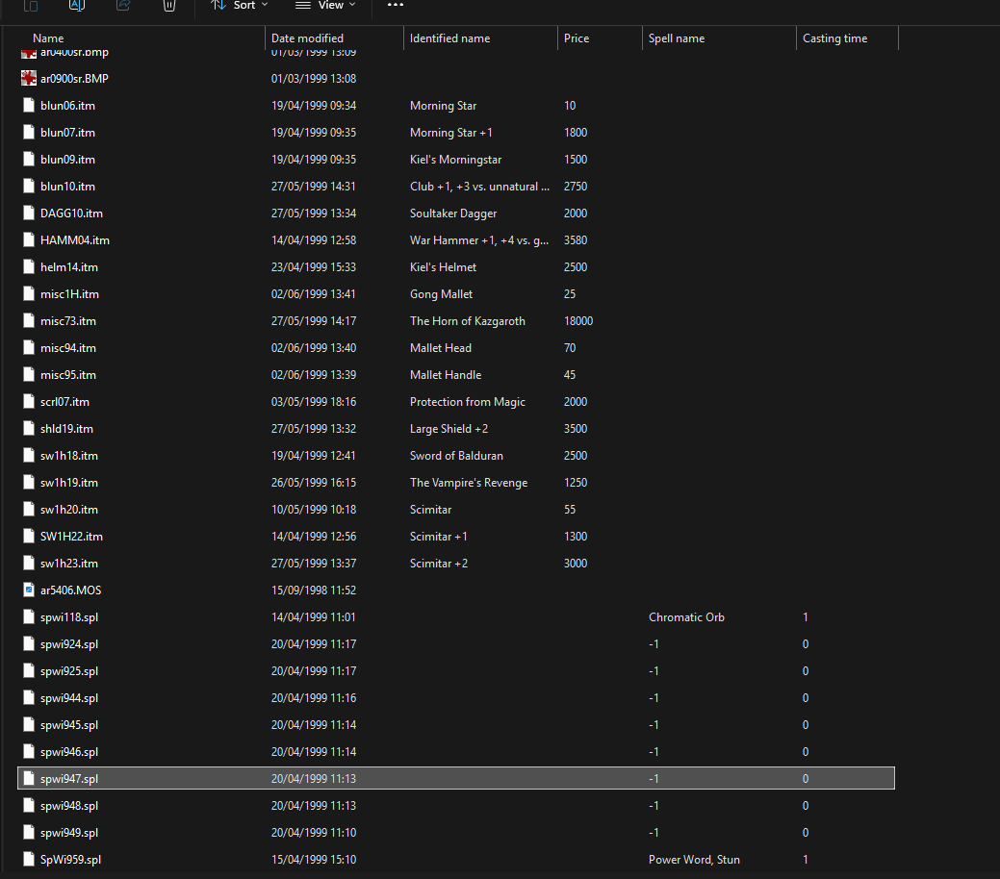

# ieColumn property handler

Windows Explorer supports a column view when viewing a folder. The columns displayed in this view are customisable via the property handler interface.
ieColumn exposes a general purpose JSON driven column registration mechanism, with some IE specific tweaks.

Columns are defined in `ieColumn.json`, so you can show a header field such as price, or a calculated field such as the damage dice on the first ability.





## Compiling

Open `ieColumn.sln` in Visual Studio and build **Release | x64** or **Release | Win32** or from a command prompt:

```powershell
msbuild ieColumn.sln /p:Configuration=Release /p:Platform=x64
msbuild ieColumn.sln /p:Configuration=Release /p:Platform=Win32
```

Output:

- `bin\x64\Release\ieColumn.dll`
- `bin\x64\Release\ieColumn.json`

- `bin\Win32\Release\ieColumn.dll`
- `bin\Win32\Release\ieColumn.json`

Property Handlers are restricted to the bitness of the running application, i.e. 32 or 64 bit.
Windows Explorer in Windows 11 is 64bit, so only the 64bit DLL is needed, however if you run 32bit applications you will also need the 32bit DLL.

## Installation

Register:
From an elevated 64-bit command prompt:

```powershell
regsvr32 bin\x64\Release\ieColumn.dll
regsvr32 bin\Win32\Release\ieColumn.dll
```
Registration reads `ieColumn.json` from the DLL's folder (or from the registry override below), writes `ieColumn.propdesc` beside the DLL, registers the COM object for every extension listed in the config, and installs that schema. 

Registered extension list is stored at `HKLM\SOFTWARE\InfinityEngine\ieColumn\RegisteredExtensions`.

Unregister:
From an elevated 64-bit command prompt:
```powershell
regsvr32 /u bin\x64\Release\ieColumn.dll
regsvr32 /u bin\Win32\Release\ieColumn.dll
```
Restart Explorer after registering or after changing labels, ids, or value types.

## Configuration

### Overview

`ieColumn.json` is a list of type handlers.
`ieColumn.schema.json` is a jsonschema for use with editors.

The JSON file contains multiple handlers, each associated with a file type. A handler consists of several fields:
- An `id` (used in property names `InfinityEngine.{id}.{column}`)
- One or more `extensions` e.g. `".itm"`
- A `formatId` GUID - this should be unique
- An optional magic-byte `signature`- an even number of bytes in hex, e.g. 49544D2056
- The type's `columns`

Note: An extension can belong to only one handler.

By default the JSON file is read from the same directory as the DLL however an alternative location can be specified via a registry key:

```text
HKLM\SOFTWARE\InfinityEngine\ieColumn
    ConfigPath = C:\path\ieColumn.json
```

### Format

Each column needs an `id`, a display `label`, a unique `propId` (2 or greater), a `valueType`, and a `rule`.

| valueType | Stored as |
| --- | --- |
| `u8` `u16` `u32` | unsigned number |
| `i8` `i16` `i32` | signed number |
| `resref` | 8-character resource name |
| `string` | text from `format` or `flags` |
| `strref` | `dialog.tlk` text for a u32 string reference, or the number if the TLK cannot be read |
| `enum` | label from the column's `enum` table, or the raw number if it is missing |

`strref` columns use the same `%ieshellex%\config\tlkLocations.xml` file as [ieshellex](https://github.com/btigi/ieshellex).
The longest `ApplyPath` contained in the item's directory selects `TlkPath`.

`type` can be omitted when `valueType` is already a width (e.g. `u32`, `resref`). `enum` rules must set `type`.

### absolute

Read one field at a fixed offset (e.g. from a header):

```json
{
  "id": "Price",
  "label": "Price",
  "propId": 101,
  "valueType": "u32",
  "rule": { "kind": "absolute", "offset": "0x34" }
}
```

### indirect

Read a u32 at `baseOffset`, treat it as a file offset, then read `type` at `base + index * stride + fieldOffset` (e.g. from an extended header).

```json
{
  "id": "Speed",
  "label": "Speed factor",
  "propId": 120,
  "valueType": "u8",
  "rule": {
    "kind": "indirect",
    "baseOffset": "0x64",
    "index": 0,
    "stride": 56,
    "fieldOffset": "0x12",
    "type": "u8"
  }
}
```

### format

Fill `{name}` placeholders from nested rules:

```json
"template": "{dice}d{sides}+{bonus}"
```

### flags

Read an integer and join the names of the set bits, lowest bit first:

```json
"rule": {
  "kind": "flags",
  "offset": "0x18",
  "type": "u32",
  "bits": { "1": "Two-handed", "6": "Magical" }
}
```

`flags` can also use `baseOffset`, `index`, `stride`, and `fieldOffset` instead of `offset`.

### Notes
A column can be set as `"enabled": false` to hide it without deleting it from the JSON file.

## Viewing the columns

1. Open a folder containing files of the relevant type(s)
2. Switch to Details view
3. Right-click a column header, choose **More...**, and enable labels such as **Item type**, **Price**, or **Damage**.

## Licencing

ieColumn is licenced under the GPL 2.0 License. Full licence details are available in licence.md

JSON parsing uses [nlohmann/json](https://github.com/nlohmann/json) licensed under MIT.